# System architecture

KAQG turns one PDF into a reusable knowledge graph and one or more batches of four-option, single-answer questions. Graph building and question generation are separate jobs. Both use the same local inference configuration, and later question batches can start from the saved graph.

```mermaid
flowchart LR
    UI[React workspace] <-->|Local HTTP and status polling| Web[Python web server]
    CLI[Command line] --> Worker[PDF and question runner]
    Web -->|One active worker at a time| Worker
    PDF[Source PDF] --> Ingest[PDF retrieval and graph construction]
    Worker -->|Graph build| Ingest
    Ingest -->|AgentFlow messages via Mosquitto| Neo[Temporary Neo4j]
    Ingest --> Model[Ollama and Qwen]
    Neo -->|Export| Saved[Knowledge graph JSON]
    Saved --> Evidence[Outline and connected evidence paths]
    Worker -->|Saved graph generation| Evidence
    Evidence --> Generate[KAQG generator and evaluator]
    Generate -->|Generation, answer check, scoring| Model
    Generate -->|Validated assessments| Results[Question JSON and optional candidate pool]
    Web -->|Optional QUBO selection| Results
    Results -->|Browse, take a quiz, export| UI
```

## Components and responsibilities

| Layer | Source | Responsibility |
| --- | --- | --- |
| React + Vite client | [`web/src/main.jsx`](../web/src/main.jsx), [`Graph.jsx`](../web/src/Graph.jsx), [`Syllabus.jsx`](../web/src/Syllabus.jsx), [`QuizAttempt.jsx`](../web/src/QuizAttempt.jsx) | Upload and controls, job activity, graph explorer, saved result views, and a browser-side quiz attempt |
| Local HTTP server | [`apps/serve_web.py`](../apps/serve_web.py) | Serves the built frontend, validates requests, runs a child process, and publishes saved state and downloads |
| Worker launcher | [`apps/pdf_to_mcq.py`](../apps/pdf_to_mcq.py) | Prepares inference and temporary services, builds or reads the graph, and coordinates question acceptance |
| PDF and graph services | [`pdf_retriever.py`](../src/retrieval/pdf_retriever.py), [`file_service.py`](../src/services/file_service.py), [`kg_service.py`](../src/services/kg_service.py), [`knowledge_graph.py`](../src/knowsys/knowledge_graph.py) | Extract page evidence, build triplets, and write or query Neo4j |
| Inference adapter | [`llm_service.py`](../src/services/llm_service.py), [`chat_llm.py`](../src/services/llms/chat_llm.py) | Bridge prompts to an OpenAI-compatible chat endpoint and pass structured response schemas |
| Evidence and selection | [`apps/syllabus.py`](../apps/syllabus.py), [`graph_reasoning.py`](../apps/graph_reasoning.py), [`assessment_selector.py`](../apps/assessment_selector.py) | Resolve chapter scopes, sample connected paths, and select a fixed-size quiz from validated candidates |
| Generation and evaluation | [`scq_generator.py`](../src/generation/scq_generator.py), [`scq_evaluator.py`](../src/evaluation/scq_evaluator.py) | Produce and verify single-answer questions and evaluate seven features |

## Execution modes

| Entry point | Source | Runtime and output |
| --- | --- | --- |
| Web **Build graph** or CLI `--graph-only` | Uploaded PDF | Prepares Ollama, a rootless Podman API socket, Mosquitto, and Neo4j. AgentFlow workers exchange messages over MQTT. Exports the graph and a summary. |
| Web **Generate questions** or CLI `--from-graph … --graph-reasoning` | Saved graph JSON and optional original PDF for syllabus structure | Derives scoped paths in Python. Calls the original generator and evaluator handlers in-process using a direct `ChatLLM` adapter. The local mode starts Ollama and skips Podman, MQTT, and Neo4j for this job. |
| CLI `--from-graph` without `--graph-reasoning` | Saved graph JSON | Restores the export to temporary Neo4j and uses the MQTT-backed workers. A supplied syllabus can provide scoped page evidence. |
| CLI with a PDF and no graph-only flag | Uploaded PDF | Builds a temporary graph and generates questions in one invocation. Add `--graph-output` to keep the graph export. |

The earlier KAQG scripts for document ingestion, question-bank generation, and ranker experiments are separate CLI entry points. The React workspace wraps `pdf_to_mcq.py` through the local HTTP server.

## Process and data lifetime

- The web server is a Python `ThreadingHTTPServer` bound to `127.0.0.1`. A `Workspace` instance allows one graph or question job at a time. A worker thread manages the child process while HTTP remains available for polling and artifact reads.
- The worker uses an `ExitStack` to stop services and AgentFlow workers and remove the temporary job directory. The runtime log files, original upload, graph export, and accepted question artifacts survive job cleanup.
- Local inference uses the installed `qwen3-vl:4b-instruct` via Ollama's loopback OpenAI-compatible endpoint. Each worker starts Ollama with cloud access disabled, an 8,192-token context setting, and one parallel request. The CLI also supports a hosted endpoint. The web launcher explicitly chooses local inference.
- Neo4j and Mosquitto listen on dynamically assigned loopback ports during graph jobs. The worker generates a temporary MQTT password and starts the temporary Neo4j instance with authentication disabled on loopback. The React graph viewer reads the exported graph from the web API, so it works after the Neo4j container exits.
- The web handler records one current job and artifact pointer per document in a local JSON file. The system uses a single-user workspace and a file-based history of generated artifacts. See [API and storage](api-and-storage.md) for publication and restart semantics.
